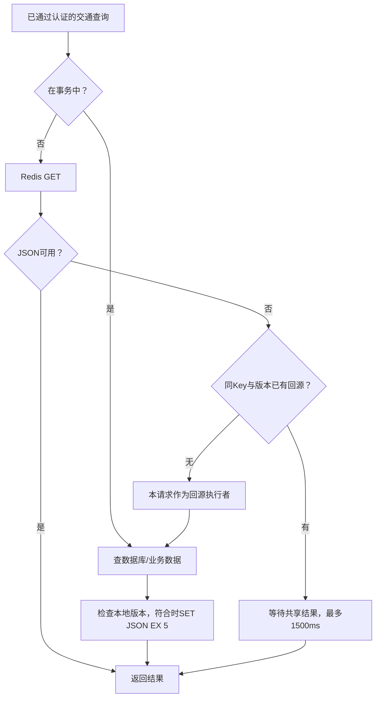

# 从 ITMS-BD 的实际代码开始学习 Redis

版本：2026-10-17。本文取代早期“Redis 只是扩展点”“第 5 次失败仍可正确登录”“退出写失败被吞掉”“没有 Lua”的旧描述。历史测试报告保留原始语义，当前行为以代码和 [本轮回归](docs/testing/project-completion.md) 为准。

先记住业务问题：交通看板反复读同一份数据，退出后的 JWT 需要立即失效，连续错误登录需要短时间锁定。Redis 在项目中分别负责这三件事。

## 1. Redis 与 Java、Spring Boot、PostgreSQL 是什么关系

| 名称 | 在本项目的职责 |
| --- | --- |
| Java | 编写接口、业务计算、校验与并发控制的语言 |
| Spring Boot | 把 Web、Security、JPA、Redis、Kafka 等组件组装成后端应用 |
| PostgreSQL | 持久保存用户、交通记录、预测、信号、路线、告警、日志和消费回执 |
| Redis | 独立进程，通过网络访问；保存短寿命认证状态和短时重复查询结果 |
| StringRedisTemplate | Java 代码访问 Redis 的客户端封装 |
| Kafka | 交通数据异步传递、消费重试与死信；当前消息链路没有换成 Redis Stream |

Redis 是按 Key 访问的数据存储，数据主要驻留内存。它支持多种数据结构和原子命令，适合快速查询、TTL 到期删除和计数。Redis 也支持持久化，但这不等于它自动替代 PostgreSQL 的事务和关系查询。

**为什么本项目选择 Redis：** 认证状态要在多个请求间共享、每项状态有明确到期时间；交通热点数据重复读取多、允许短时间缓存；Java 有成熟客户端。仅有一个小型低频演示时直接查库也能工作，引入 Redis 的价值来自这些具体需求和可验证的行为。

## 2. 用最小实验认识 Key、Value、TTL

运行 [独立教学实验](docs/redis-lab/README.md)，该容器没有映射宿主机端口，不使用业务 Redis。仓库根目录执行：

```powershell
docker compose -f .\docs\redis-lab\compose.yml up -d
docker compose -f .\docs\redis-lab\compose.yml exec -T redis redis-cli SET learn:itms:manual:hello world EX 60
docker compose -f .\docs\redis-lab\compose.yml exec -T redis redis-cli GET learn:itms:manual:hello
docker compose -f .\docs\redis-lab\compose.yml exec -T redis redis-cli TTL learn:itms:manual:hello
docker compose -f .\docs\redis-lab\compose.yml exec -T redis redis-cli DEL learn:itms:manual:hello
```

Key 是名字，Value 是内容，EX 60 表示 60 秒后到期。TTL 返回剩余秒数；-1 表示存在但没有到期时间，-2 表示 Key 已不存在。PTTL 使用毫秒。SET 加 EX/PX 在同一条命令内完成，避免先 SET 再 EXPIRE 中间进程中断留下永久 Key。

JSON 仍然是 String：Redis 不会自动理解 JSON 中的字段。交通缓存用整个 JSON 字符串存取，再由 Jackson 反序列化为列表。

**验收：** 能不看笔记解释 SET/GET/DEL/TTL、TTL=-1/-2，知道 Redis 中的字符串与 Java String 对象分属不同进程。

## 3. 项目真实 Key 设计

| Key | Value | TTL | 代码 |
| --- | --- | --- | --- |
| `itms:auth:revoked:{SHA256(token)}` | `"1"` | Token 剩余有效期（毫秒） | RedisAuthServiceImpl.revokeToken |
| `itms:auth:login-failed:{SHA256(trim/lowercase(username))}` | 失败次数 | 首次失败10分钟；第5次重置为完整10分钟锁定 | recordLoginFailure 等 Lua |
| `itms:traffic:realtime` | 最新方向数据 JSON | 5秒 | TrafficDataServiceImpl.cachedRows |
| `itms:traffic:intersection-summary` | 路口汇总 JSON | 5秒 | 同上 |

前缀区分业务，摘要避免把原始 Token/用户名直接放在 Key 中，TTL 自动回收过期状态。摘要是单向哈希，不是加密后的可恢复 Token。摘要 Key 也应按认证数据管理。

当前没有使用 Redis Hash 存用户、ZSet 存排行榜、Stream 接交通流、Redis 分布式锁控制信号灯。这些可在教学实验中练习，与项目已经实现的范围分开讲。

## 4. JWT 撤销：为什么登录用了 JWT，还需要 Redis

JWT 签名正确且未过期时，可以独立验证。用户点击退出，只删浏览器里的 Token 不会让已复制的 Token 立即无效。因此后端把该 Token 的摘要放进撤销名单。

```text
登录 → BCrypt 验证 → 签发 JWT
每次请求 → 校验 JWT → Redis 查撤销 → PostgreSQL 查当前用户/版本/角色
退出 → Redis SET 撤销摘要 EX/PX 剩余时间
再次使用旧 Token → 撤销检查命中 → 401
```

撤销 TTL 只需要覆盖 Token 剩余有效期；Token 本身到期后，撤销记录自然失去必要性。新登录生成的另一个 Token 使用不同摘要，不受这条撤销记录影响。

当前还用数据库 `authVersion` 处理改密/禁用等账号变化；角色按数据库当前值读取。Redis 撤销主要针对**某个具体 Token 的退出**。

**故障策略：** 撤销查询或撤销写入失败返回 503。退出接口不把写失败当作成功。每个受保护请求先依赖 Redis 认证状态，再进入交通业务，故“停 Redis 后所有业务都直接查库成功”与当前实现不符。

**实验：** 登录后记住当前 Token，先调用 /auth/me，再调用 /auth/logout，最后再次用旧 Token 访问 /auth/me，预期 401。用 `SCAN` 查看 `itms:auth:revoked:*`；不要把 Token 写到文档或日志。

## 5. 登录失败计数：Lua 为什么有必要

需求是：连续错误达到 5 次后锁定 10 分钟，正确密码也要等锁定结束；低于阈值时成功登录清理失败计数。

单独 `INCR` 然后 `EXPIRE` 有中断窗口。项目把相关命令放入 Lua，使该脚本执行期间其他 Redis 命令不穿插修改这组状态。

实际关键逻辑：

```lua
local count = redis.call('INCR', KEYS[1])
if count == 5 or redis.call('PTTL', KEYS[1]) < 0 then
    redis.call('PEXPIRE', KEYS[1], ARGV[1])
end
return count
```

- 第 1 次失败创建计数，并设置 600000ms 窗口。
- 第 2～4 次失败增加计数，不延长已有计数窗口。
- 第 5 次失败重新设置完整 10 分钟锁定时间。
- 锁定期间先读锁状态，直接返回 429，不继续检查正确密码，也不刷新锁定时间。
- 锁定到期 Key 消失，新的尝试重新开始。
- 登录成功时用另一段 Lua 检查计数仍小于 5 才删除；避免并发失败刚达到阈值后被成功请求误清理。

Lua 保证 Redis 状态检查与修改原子执行，不能自动把 Redis 和 PostgreSQL 组合成一个分布式事务。脚本宜短小，耗时计算会占用 Redis 命令处理时间。

**实验：** 使用专门测试用户名连续输错 5 次，记录前4次401、第5次429和 Retry-After；立即输入正确密码仍429。不要用当前演示管理员做锁定实验，以免影响其他学习步骤。自动化回归见 AuthServiceTest、RedisAuthFailureTest、RedisApplicationIT。

**与教学脚本的差别：** redis-lab 的 failure_count.lua 演示“从首次失败起固定窗口”，未实现业务中第5次重置锁定窗口；attempt_limit.lua 统计所有尝试，无论密码是否正确。两者都适合练习原子操作，但不直接代表登录业务规则。

## 6. 交通缓存：一次读取实际走哪些分支



缓存命中时省掉交通 Repository 查询；接口认证仍查用户表。缓存未命中/JSON损坏/缓存命令错误时尝试数据库。数据库自身故障不会被伪装成有效空数据。

两个热 Key 分别缓存方向明细与路口汇总，summary/heatmap 复用汇总结果。5 秒 TTL 是当前演示数据刷新频率下的工程选择；它在实时程度、重复计算与内存占用之间取平衡，并非普遍最优值。

空查询结果也能保存为 JSON 空数组，短时间减少反复读取空表。按路口动态 Key、布隆过滤器、热 Key 自动分片等不在当前实现内。

## 7. 并发未命中：合并回源与等待上限

假设缓存到期，20 个请求同时过来。若每个请求都查交通表，会把一次失效放大为20次数据库读取。

项目使用 `ConcurrentHashMap<CacheLoadKey, CompletableFuture<...>>`，CacheLoadKey 包含 Key 与本地 generation：

1. 第一个请求用 putIfAbsent 成为执行者。
2. 后续请求拿到同一个 Future，等待同一结果。
3. 执行者再次查缓存，减少 GET 与抢占之间重复回源的窗口。
4. 执行者完成结果或异常，再由它删除在途记录。
5. 等待者最多等1500ms，超时返回503，但不删除执行者的在途记录。

这样能限制同实例的缓存重建数量。它是**进程内回源合并**，没有 Redis 分布式锁；多个 JVM 仍可能分别回源。缓存失效或 Redis GET 异常的短时并发，仍能共享当前执行者结果。

## 8. 写入一致性：提交后失效与旧值回填

正确性需要考虑两个时间问题。

**问题 A：事务还没提交就删缓存。** 另一个请求读数据库旧值再填缓存，即使原事务随后成功，也会留下旧缓存。因此正常事务路径在 `afterCommit` 删除，回滚不触发提交回调。事务内读取绕过共享缓存，不把未提交数据发布到 Redis。

**问题 B：旧读已经在路上。**

```text
线程A：缓存miss，记下generation=7，开始查旧数据
线程B：新数据事务提交 → 持有本地变更锁 → 删除两个Key → generation=8
线程A：旧查询返回 → 获取同一把变更锁 → 发现7≠8 → 不回填
```

缓存 SET 与 DEL/版本推进使用同一把本地锁；版本在 DEL 尝试结束之后递增，避免删除进行中启动的旧代查询误变为新代。等待中的旧请求仍可能拿到它当时的旧查询结果，本方案保证的是避免该旧结果重新污染缓存，未宣称所有交叠请求都获得线性一致的新值。

删除 Redis 失败时，旧 Key 保留原短 TTL，本地版本仍推进。外部直接改数据库、另一实例写入/回填等仍需额外一致性设计；本地锁和版本无法跨进程协调。

相关回归：TrafficDataConcurrencyTest、TrafficDataTransactionTest、TrafficIngestionPostgresIT。

## 9. Redis 异常怎样处理

| 故障 | 当前行为 | 为什么 |
| --- | --- | --- |
| 交通缓存 GET/反序列化失败 | 视为 miss，尝试业务回源 | 缓存是加速层 |
| 交通缓存 SET 失败 | 已取得数据库结果仍可返回 | 读成功不依赖缓存保存成功 |
| 提交后缓存 DEL 失败 | 保留短 TTL，本地版本推进 | 限定陈旧时间，防本实例旧查询回填 |
| 登录锁定状态/Token撤销查询失败 | 503 | 无可靠认证状态时不继续认证 |
| 退出撤销写失败 | 503 | 不声称退出已完成 |
| 数据库查询/连接/锁等待超时 | 503 + Retry-After | 下游故障与“查不到数据”分开表达 |
| 缓存共享结果等待超时 | 503 | 防止等待占满线程 |

单测中的“缓存出错仍回源”只针对业务 Service 边界。通过 HTTP 验证整台 Redis 故障时还会经过前面的认证过滤器，因此预期是503。解释测试时务必指出调用的是哪一层。

## 10. 如何观察实际 Key

按 README 启动系统，在 [项目学习地图](docs/project-guide.md) 中完成登录和暂停模拟器。调用实时接口后：

```powershell
docker compose exec -T redis redis-cli --scan --pattern 'itms:traffic:*'
docker compose exec -T redis redis-cli TYPE itms:traffic:realtime
docker compose exec -T redis redis-cli TTL itms:traffic:realtime
docker compose exec -T redis redis-cli GET itms:traffic:realtime
docker compose exec -T redis redis-cli INFO stats
docker compose exec -T redis redis-cli INFO memory
```

SCAN 可逐步遍历，不把阻塞式全库枚举作为日常查询。实验只删除自己的 learn: 前缀键，不运行清空数据库的命令。

注意 INFO stats 的 keyspace_hits/misses 是该 Redis 实例全部查询的累计统计，含认证访问；需要采样前后差值，并隔离其他流量。它不直接等于交通业务缓存命中率。

## 11. 持久化、淘汰与部署要了解多少

业务 Compose 配置 Redis AOF 和命名卷，停止并重启容器可恢复已有持久化数据。AOF 恢复和 TTL 的正确性仍受落盘策略、崩溃时点、备份与部署方式影响。项目默认配置没有建立 Redis Sentinel/Cluster 或跨机容灾。

“5秒缓存可重建”与“退出撤销状态有业务含义”对丢失的容忍度不同。若生产把两者混用同一实例，还应设计内存预算、maxmemory-policy、认证状态保护、监控和故障切换。当前仓库没有用生产 HA 测试证明这些能力。

TTL 到期策略、淘汰策略、RDB/AOF、主从复制、Sentinel、Cluster 是后续知识。先用项目解释三个实际场景，再把这些基础补齐，避免把学习过的名词都写成项目实现。

## 12. 从零学习安排与验收

| 单元 | 建议用时 | 做什么 | 学会的标志 |
| --- | --- | --- | --- |
| 1 基本概念 | 45分钟 | 学第1～2节并操作 SET/GET/TTL | 能解释独立服务、Key、到期 |
| 2 项目定位 | 45分钟 | 读三类 Key 和源码方法 | 能指出数据来自哪里、何时删除 |
| 3 认证状态 | 60分钟 | 登录/退出/旧Token实验 | 能解释 JWT 与撤销的分工 |
| 4 原子计数 | 60分钟 | 读 Lua、做5次失败实验 | 能解释阈值、TTL与并发清理 |
| 5 缓存链路 | 60分钟 | 观察缓存内容、过期、回源 | 能画命中和未命中路径 |
| 6 并发一致性 | 90分钟 | 手画旧读/新写时序，读相关测试 | 能解释 Future、generation、afterCommit |
| 7 故障验证 | 60分钟 | 在隔离测试中验证 Redis/DB异常 | 能区别业务降级与认证依赖 |
| 8 面试复述 | 45分钟 | 30秒、3分钟各讲一次 | 每个结论都有代码或测试来源 |

一天可走完第一遍，第二天重点复做并发/故障实验。完整集成测试使用 [测试入口](docs/testing/quickstart.md)，Hash/List/Set/ZSet/Stream/令牌锁练习使用 [独立实验目录](docs/redis-lab/README.md)。

推荐参考资料：

- [Redis 官方数据类型](https://redis.io/docs/latest/develop/data-types/)
- [Redis 官方命令参考](https://redis.io/docs/latest/commands/)
- [Redis Lua 脚本介绍](https://redis.io/docs/latest/develop/programmability/eval-intro/)
- [Spring Data Redis 文档](https://docs.spring.io/spring-data/redis/reference/)

外部教程补概念；项目行为仍以当前源码与测试为依据。

## 面试回答示例

**为什么选 Redis？**

“交通看板有很多短时间重复读取，Redis 能缓存最新交通结果，减少重复查交通表。另外 JWT 本身在有效期内仍可用，我用带 TTL 的摘要 Key 做退出撤销；错误登录通过 Lua 原子计数和到期时间实现锁定。所以选型来自缓存、共享临时状态和原子计数这三个需求。”

**高并发下缓存怎么保证？**

“缓存5秒到期，读未命中在本实例按 Key 和版本合并回源，其他请求最多等待1500ms。写入在数据库事务提交后删除两个热点 Key，推进本地版本；旧查询回填前检查版本，并与失效共享本地锁。这个方案解决本实例回填竞争，多实例同步仍需要扩展。”

**Redis 挂了怎么办？**

“分用途：交通缓存失败时 Service 尝试数据库，认证状态失败返回503。当前请求在进入业务前会先查Redis撤销状态，所以整台Redis故障时受保护HTTP接口会在认证层返回503。随后应通过监控和部署恢复依赖，数据库连接池和准入限制避免无界资源占用。”
