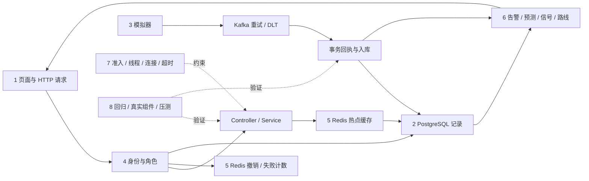

# 按八个部分直观学习 ITMS-BD

先把项目看成一个交通管理工作台：采集一条路口数据，存下来，给人看，按规则计算建议，再记录谁做了什么。学习时每次只走通一条线；先完成下面的实验，再读相邻模块。

本指南对应 2026-10-17 的代码。预测是模拟算法，信号方案是数据库内的规则计算，路网是静态演示路网；真实传感器、模型推理服务、道路信号机和集群高可用尚未接入。

## 总览：八块内容如何连起来



推荐顺序是 1 → 2 → 3 → 4 → 5 → 6 → 7 → 8。第一次只读每节“业务问题、实验、验收”，第二次再沿源码进入实现。

## 实验准备

按 [README](../README.md) 启动本地 Compose，打开前端。以下 PowerShell 例子使用默认管理员演示账号；已有账号改过密码时使用实际密码。所有请求指向本机。

本机本轮已经启动的学习环境使用前端 `http://127.0.0.1:13000`、后端 `http://127.0.0.1:18080`；采用它时，将下面 `$base` 改成 `http://127.0.0.1:18080`。其依赖运行在 WSL，Redis 使用16379端口的DB2，相关查看命令见[部署文档第5节](deployment.md#5-本轮本机学习环境wsl-依赖)。默认 Compose 示例仍使用8080端口、Redis DB0，二者选一套即可。

```powershell
$base = 'http://localhost:8080'
$login = Invoke-RestMethod -Method Post -Uri "$base/api/auth/login" -ContentType 'application/json' -Body '{"username":"admin","password":"123456"}'
$headers = @{ Authorization = "Bearer $($login.data.token)" }
Invoke-RestMethod -Uri "$base/api/auth/me" -Headers $headers
```

希望逐条观察时先暂停自动模拟，避免新数据覆盖自己输入：

```powershell
Invoke-RestMethod -Method Post -Uri "$base/api/traffic/simulator/stop" -Headers $headers
```

暂停只停止后续定时生成，已经进入 Kafka 的数据仍可能被消费。待历史记录数稳定后再做固定值实验。结束学习后用 `POST /api/traffic/simulator/start` 恢复。Token 只留在当前终端内存中，不复制到 Git 文档。

## 1. 页面数字怎么来：一条读取请求

**业务问题：** 看板上的“平均速度”怎样从数据库走到浏览器？

**先记这条线：**

```text
Dashboard/TrafficMonitor
  → services/api.ts 发 GET /api/traffic/heatmap（同时请求 realtime）
  → Nginx 或开发代理
  → Security：准入、Token、当前用户与角色
  → TrafficDataController.getHeatmapData
  → TrafficDataServiceImpl.getHeatmapData → getIntersectionSummary：按交通数量加权汇总
  → Redis 缓存或 TrafficDataRepository
  → Result {code,message,data}
  → React 状态与图表
```

核心代码：[api.ts](../frontend/src/services/api.ts)、[Dashboard.tsx](../frontend/src/pages/Dashboard.tsx)、[TrafficDataController](../backend/src/main/java/com/itms/controller/TrafficDataController.java)、[TrafficDataServiceImpl](../backend/src/main/java/com/itms/service/impl/TrafficDataServiceImpl.java)。

**动手实验：**

1. 浏览器开发者工具打开 Network，切到看板，找到 `/api/traffic/heatmap` 和 `/api/traffic/realtime`。
2. 查看请求方法、Authorization 头、heatmap 响应中每个路口的 `averageSpeed`，与地图提示数字对照。看板总平均速度还会在前端按各路口数量加权。
3. 在终端请求相同接口：

```powershell
Invoke-RestMethod -Uri "$base/api/traffic/heatmap" -Headers $headers
```

4. 退出登录后刷新受保护页面，观察登录跳转；后端无凭据请求返回 401。
5. 在 `api.ts` 找到 8 秒请求超时和 401/403/429/503 的分支。403、429、503 保留登录状态；非登录接口的 401 清理会话。

补充：`GET /api/traffic/summary` 是独立的汇总接口，可在终端调用比较；当前看板没有直接调用这个接口。

**验收：** 能指出“前端展示”“接口路由”“业务计算”“持久化”的具体文件；知道 REST 是接口设计方式，当前传输是 HTTP/JSON，底层通常是 TCP。页面轮询与 WebSocket 是不同实现。

**面试口述：** “前端通过 Axios 调用 REST 接口，统一附带 JWT。后端先做准入和身份权限校验，再由 Controller 调用 Service。Service 负责缓存和加权汇总，Repository 查询 PostgreSQL，最后用统一响应结构交给图表。”

## 2. 一条交通记录是什么：对象、表与最新值

**业务问题：** INT-001 北向的交通数据和南向数据如何区分？不同路口的上报时间不一致时会漏掉路口吗？

一条 `TrafficData` 表示一个路口、一个方向、一个采样时间的数量、速度、占用率和拥堵等级。核心标识是 `intersectionId + direction + recordTime`，数据库 `id` 是自增记录号。

实时查询为**每个路口/方向分别取最新记录**，同一时间用更大的 `id` 决定先后。它不要求所有路口的时间戳相同。数量按当前采样值解释；未进行小时归一化时，不把它讲成实测“辆/小时”。

核心代码：[TrafficData](../backend/src/main/java/com/itms/entity/TrafficData.java)、[TrafficDataRepository](../backend/src/main/java/com/itms/repository/TrafficDataRepository.java)、[TrafficValidation](../backend/src/main/java/com/itms/service/impl/TrafficValidation.java)、[TrafficNetwork](../backend/src/main/java/com/itms/common/TrafficNetwork.java)。

**动手实验：**

```powershell
$sample = @{
  intersectionId = 'INT-001'; direction = 'NORTH'
  vehicleCount = 100; avgSpeed = 10; congestionLevel = 2
  recordTime = (Get-Date).ToString('yyyy-MM-ddTHH:mm:ss')
  dataSource = 'MANUAL'
} | ConvertTo-Json
Invoke-RestMethod -Method Post -Uri "$base/api/traffic/save" -Headers $headers -ContentType 'application/json' -Body $sample
$rows = Invoke-RestMethod -Uri "$base/api/traffic/realtime" -Headers $headers
$rows.data | Where-Object { $_.intersectionId -eq 'INT-001' -and $_.direction -eq 'NORTH' }
Invoke-RestMethod -Uri "$base/api/traffic/history?intersectionId=INT-001&limit=10" -Headers $headers
```

路口名称、经纬度由已知路网规范化；未给时间时后端填写当前时间。尝试 `vehicleCount=-1`，预期 400，数据库不新增该非法记录。

加权均速的小题：北向 100 辆/10 km/h，南向 300 辆/30 km/h，仅考虑这两条时为 `(100×10+300×30)/400=25 km/h`。项目实际汇总还会纳入同路口其他方向，验证时需一起计算。

**验收：** 能解释实体属性如何映射数据库列，为什么要按路口和方向分组取最新值，为什么均速采用数量加权。历史请求 `minutes` 默认 60、范围 1～2880，最多 1000 条；`limit` 范围 1～1000，提供时优先，时间范围最近两天，响应按时间正序。定时任务每 30 分钟删除 recordTime 超过两小时的数据，查询上限不代表保存期限。

**面试口述：** “我们把一条采样数据建模为路口、方向和时间对应的交通状态。实时查询按每个路口和方向取最新值，避免异步上报时只取全表最大时间漏掉其他路口，历史查询在数据库端限制条数。”

## 3. 新数据进入系统：模拟器与 Kafka

**业务问题：** 为什么页面刷新不直接生成数据？大量上报时为什么引入消息队列？

读取和采集分开：模拟器每批生成 14×4 条记录，通过 Kafka 异步送入消费者。消费服务先在 PostgreSQL 中登记消息回执，再保存交通数据、更新告警；这些操作在同一事务内完成，提交后删除交通缓存。

核心代码：[TrafficSimulatorServiceImpl](../backend/src/main/java/com/itms/service/impl/TrafficSimulatorServiceImpl.java)、[TrafficKafkaConsumer](../backend/src/main/java/com/itms/service/impl/TrafficKafkaConsumer.java)、[TrafficIngestionServiceImpl](../backend/src/main/java/com/itms/service/impl/TrafficIngestionServiceImpl.java)、[KafkaConsumerConfig](../backend/src/main/java/com/itms/config/KafkaConsumerConfig.java)。

**动手实验：**

```powershell
$batch = Invoke-RestMethod -Method Post -Uri "$base/api/traffic/simulator/generate-once" -Headers $headers
$batch.data.Count
Invoke-RestMethod -Uri "$base/api/traffic/realtime" -Headers $headers
docker compose logs --tail 60 backend
```

应生成 56 条记录；HTTP 返回表示生成并发起发送，消费落库可能稍后完成。比较调用前后的历史记录，看到记录时间变化后再下结论。交通 GET 不自动补数据。

消息异常重试 2 次，每次间隔默认 1 秒，仍失败则送到 `traffic-data.DLT` 对应分区；DLT 投递失败也会被当作故障处理。同组同 topic/partition/offset 的 SHA-256 回执键保证该消息位置只执行一次数据库效果，失败事务会回滚回执，允许之后重试。

业务层另有 `eventId` 与服务端内容摘要：相同 ID、相同原始业务内容返回已有记录，不重复告警与缓存失效；同 ID 内容冲突返回 409，Kafka 消费时进入重试/DLT。模拟器发送前生成 UUID，发送失败直写与 Kafka 迟到消费共用同一 ID。同步 send 失败后该批剩余记录直接落库，避免每条重复等待 Kafka；异步回退若数据库也失败，会记录 ERROR 与重放内容，目前没有持久失败队列。

**补充实验：** 在第 2 节对象中加上 `eventId = 'learn-' + [Guid]::NewGuid().ToString()`，生成一次 JSON 后连续提交完全相同的原请求，返回 id 应一致；保持 eventId 改 vehicleCount，预期409。eventId 只使用字母、数字、冒号、下划线和连字符，长度1～64。省略 eventId 的两次独立 HTTP 请求各生成新 UUID，所以重试方要自己保留事件 ID 与原请求内容。

**验收：** 能解释异步 HTTP 返回与落库完成的区别；能说明 offset 回执与 eventId 去重分别解决哪一层重复。事件身份随交通记录保留，清理后可重新插入；offset 回执目前未配置自动清理。发送与回退全部失败时仍有数据丢失边界，当前不宣称端到端 exactly-once。

**面试口述：** “Kafka 把采集和数据库消费解耦。消费者有有限重试与死信，消息回执和业务写入在同一事务中；业务层用 eventId 加摘要处理跨入口重放，模拟器回退也复用这个 ID。我们明确了保留期限与双依赖故障的边界。”

## 4. 系统怎么知道你是谁：登录、认证、权限

**业务问题：** 为什么前端隐藏按钮还不够？管理员禁用账号后，旧 Token 会怎样？

登录时用 BCrypt 对比密码；成功生成包含用户 ID 与 `authVersion` 的 JWT。每次带 Token 请求都校验签名/有效期、Redis 撤销状态、数据库当前账号是否启用、用户名与版本，再按**数据库当前角色**授权。改密码或禁用账号会使旧认证版本失效；角色调整按当前数据库角色立即判定权限。

核心代码：[AuthServiceImpl](../backend/src/main/java/com/itms/service/impl/AuthServiceImpl.java)、[SecurityConfig](../backend/src/main/java/com/itms/config/SecurityConfig.java)、[JwtUtil](../backend/src/main/java/com/itms/util/JwtUtil.java)、[UserManagementService](../backend/src/main/java/com/itms/service/UserManagementService.java)。

**动手实验：**

1. 用 `driver1` 登录，读取实时交通应成功，调用模拟器生成应返回 403。
2. 用 `manager1` 登录，可触发模拟预测；打开用户管理接口应返回 403。
3. 用 `admin` 登录，可管理用户、查看系统日志。
4. 在另一个终端保存一个测试账号的 Token；管理员禁用该测试账号，再用旧 Token 访问 `/api/auth/me`，应返回 401。恢复启用后重新登录。
5. 用当前 Token 调用 `POST /api/auth/logout`，再次用同 Token 调用受保护接口，应返回 401。

退出实验结束后，重新登录并更新终端凭证，再进入后续 Redis 和业务实验：

```powershell
$login = Invoke-RestMethod -Method Post -Uri "$base/api/auth/login" -ContentType 'application/json' -Body '{"username":"admin","password":"123456"}'
$headers = @{ Authorization = "Bearer $($login.data.token)" }
```

不要用唯一管理员做禁用实验；项目也在数据库事务中保护最后一名启用管理员。

**验收：** 分清 401（身份无效）、403（身份有效但无权）、503（认证依赖暂不可用）。路线历史始终属于当前用户，传别人的 userId 会返回 403，管理员也适用这个本人数据约束。

**面试口述：** “JWT 提供可验证凭证，Redis 解决退出后的即时撤销，数据库当前账号状态解决禁用和角色修改。服务端统一执行权限规则，前端只负责按角色呈现交互。”

## 5. 反复查询不用反复查交通表：三类 Redis 使用

**业务问题：** 多人看相同的交通看板时，哪些查询可以共享？Redis 出错时哪些操作要停止？

| 使用 | Key / 类型 | 生命周期 |
| --- | --- | --- |
| 退出撤销 | `itms:auth:revoked:{token摘要}` / String | JWT 剩余有效期 |
| 登录失败 | `itms:auth:login-failed:{用户名摘要}` / 数值 String | 首次失败设置 10 分钟计数窗口；第 5 次失败重置为完整 10 分钟锁定 |
| 交通热点 | `itms:traffic:realtime`、`itms:traffic:intersection-summary` / JSON String | 5 秒；写事务提交后主动删除 |

核心代码：[RedisAuthServiceImpl](../backend/src/main/java/com/itms/service/impl/RedisAuthServiceImpl.java)、[TrafficDataServiceImpl](../backend/src/main/java/com/itms/service/impl/TrafficDataServiceImpl.java)。完整从零解释见 [Redis 教程](../Redis实现与面试教学.md)。

**动手实验：**

暂停模拟器后执行查询，再读取业务缓存：

```powershell
Invoke-RestMethod -Uri "$base/api/traffic/realtime" -Headers $headers | Out-Null
docker compose exec -T redis redis-cli TYPE itms:traffic:realtime
docker compose exec -T redis redis-cli TTL itms:traffic:realtime
docker compose exec -T redis redis-cli GET itms:traffic:realtime
```

本轮 WSL 学习环境将上述三条 Redis 命令替换为 `wsl -d Ubuntu-24.04 -- redis-cli -p 16379 -n 2 TYPE itms:traffic:realtime`，再分别将 TYPE 换为 TTL、GET。Kafka/后端日志改用部署文档中的本机日志路径。

应看到 String、约 0～5 秒剩余寿命、JSON。过期后 TTL 为 -2；若页面持续轮询，缓存可能重新建立。停止页面轮询再观察过期。

同时缓存失效时，同实例同 Key/版本的请求只让一个线程回源，其他等待该结果。写事务提交后删除缓存，再推进本地版本，旧查询结束后检查版本，避免把过时结果填回。事务内读取绕过共享缓存，防止发布未提交数据。

缓存命中减少的是**交通业务表查询**。认证仍查询 Redis 与用户表。交通缓存异常回源数据库；认证撤销/锁定状态异常返回 503，整台 Redis 故障时受保护 HTTP 不会越过认证依赖。

**验收：** 能画缓存命中、未命中、并发回源和提交失效四条路径；能指出本地版本与锁只协调单个 JVM，多实例强一致仍是扩展项。

**面试口述：** “Redis 一部分承载临时认证状态，一部分缓存短时重复读取的交通结果。缓存选 5 秒 TTL，并结合提交后失效与同实例回源合并控制数据库压力；认证状态查询失败会返回 503，业务缓存失败则尝试回源。”

## 6. 业务计算：预测、配时、路线与告警

**业务问题：** 存下来的记录怎样转化成用户可采取的行动？

| 模块 | 真实实现 | 学习时要守住的边界 |
| --- | --- | --- |
| 预测 | 每次 POST 生成一个 UUID 批次，趋势公式与噪声生成未来每 5 分钟一条、直到 30 分钟的结果 | `TREND_SIMULATION`、`SIMULATION-v1`、`confidence=null`；不是训练模型精度 |
| 信号 | 按南北/东西权重分配绿灯时间，验证周期与四方向完整性，先生成候选再应用 | `WEIGHTED_RULES`、`executionMode=SIMULATION`；应用修改数据库，未下发真实设备 |
| 路线 | Dijkstra；距离、时间、碳排对应不同边权 | 静态路网，时间/碳排为估计；缺数据标记 UNAVAILABLE/PARTIAL |
| 告警 | 按来源、路口、方向形成活动键，支持 UNREAD→READ→RESOLVED | 已解决为终态；实时恢复只解决同实时方向告警，不覆盖预测告警 |

核心代码位于 [service/impl](../backend/src/main/java/com/itms/service/impl/) 的 `TrafficPredictionServiceImpl`、`TrafficSignalServiceImpl`、`RoutePlanServiceImpl`、`TrafficAlertServiceImpl`。

路线学习还要区分“算得出路径”和“知道实时路况”：缺少路段任一端的近期采样，算法仍可按静态参数估算路径，但该边拥堵等级返回 null，页面显示未知。两端都有近期采样，才展示采样推导出的等级。

**动手实验 A：预测是“生成”后再“查询”。**

```powershell
Invoke-RestMethod -Method Post -Uri "$base/api/prediction/trigger" -Headers $headers
Invoke-RestMethod -Uri "$base/api/prediction/latest?intersectionId=INT-001" -Headers $headers
```

记录 batchId/modelVersion，连续 GET 不生成新批次。预测 GET 在无批次时返回空，POST 才生成模拟数据。

**动手实验 B：候选信号不等于当前信号。**

```powershell
Invoke-RestMethod -Uri "$base/api/signals/INT-001/state" -Headers $headers
Invoke-RestMethod -Method Post -Uri "$base/api/signals/INT-001/optimize?strategy=CONGESTION_FIRST" -Headers $headers
Invoke-RestMethod -Uri "$base/api/signals/INT-001/state" -Headers $headers
Invoke-RestMethod -Method Post -Uri "$base/api/signals/INT-001/apply" -Headers $headers
Invoke-RestMethod -Uri "$base/api/signals/INT-001/state" -Headers $headers
```

优化后比较 current 与 candidate；应用后 current 更新、候选清理。无候选直接应用返回 409。当前信号 GET 在无配置时可能初始化默认信号，这一点与交通/预测只读 GET 不同。

**动手实验 C：比较路径。**

```powershell
$routeBody = '{"startIntersectionId":"INT-001","endIntersectionId":"INT-014","strategy":"FASTEST"}'
Invoke-RestMethod -Method Post -Uri "$base/api/routes/plan" -Headers $headers -ContentType 'application/json' -Body $routeBody
Invoke-RestMethod -Uri "$base/api/routes/history" -Headers $headers
```

把策略换成 SHORTEST/LOW_CARBON，比较距离、预计分钟数、估计碳排克数。路径有可能相同；算法目标不同并不保证每组输入输出不同。检查 `trafficDataStatus` 与采样方向数，不把缺数据当作实测畅通。

**动手实验 D：告警生命周期。** 分两次观察：先用第 2 节接口写一条高拥堵记录，在告警列表找到对应路口/方向，标为已读再处理；处理人应为当前账号。然后以新的 eventId 和更晚的 recordTime 写另一条高拥堵记录，确认出现新的活动告警；再写同方向、更晚的畅通记录，观察活动告警自动恢复，处理人为 SYSTEM。其他方向/预测来源不应受影响。两次写入需让时间至少相差一秒，避免把时间先后实验混成同时间按 id 排序的实验。

**验收：** 能明确讲出每个功能的输入、算法、输出、落库点；不把公式估计讲成真实道路效果。

**面试口述：** “业务链路先用交通数据形成状态，预测和信号是明确标识的模拟规则，路线使用 Dijkstra，告警通过来源和方向隔离。重点在数据来源、状态流转与验证，模型部署和设备下发保留独立接入边界。”

## 7. 多人同时访问：有界资源与故障处理

**业务问题：** 请求越积越多时，是继续排队还是尽早告知稍后重试？

| 层次 | 默认设置 | 作用 |
| --- | --- | --- |
| HTTP 接入 | 最大在途 24 | 取得 Semaphore 许可才进入处理；超量 429 |
| Tomcat | 最大线程 64、连接 1024、accept-count 64 | 约束线程与连接排队资源 |
| PostgreSQL 连接池 | 最大 20、获取等待 2 秒 | 限制数据库并行占用 |
| PostgreSQL 会话 | statement_timeout 5 秒、lock_timeout 2 秒 | 避免长查询/锁等待无限占用连接 |
| 缓存重建 | 同 Key/版本共享；等待者最多 1500ms | 慢回源时返回 503，等待者超时不删除正在执行的任务 |
| 模拟器 | 单实例 tryLock | 定时批次忙则跳过，手动生成忙则 503 |
| Kafka | 默认 1 分区/副本/消费者并发 | 当前是单机演示，扩容需要一起规划分区、消费者和数据库预算 |

核心代码：[RequestAdmissionFilter](../backend/src/main/java/com/itms/config/RequestAdmissionFilter.java)、[application.yml](../backend/src/main/resources/application.yml)、[KafkaConsumerConfig](../backend/src/main/java/com/itms/config/KafkaConsumerConfig.java)。

**动手实验：** 先阅读 `RequestAdmissionTest` 和 `TrafficDataConcurrencyTest`，根据锁存器顺序手画两个线程；再按 [测试文档](testing/project-completion.md) 执行。需要观察真实 HTTP 时，使用文档中的 1→5→10→20 并发小规模压测，记录状态比例、P95 与连接池占用。

429 是明确的过载响应，计入压测失败率。503 表示依赖/等待条件暂不可用。前端显示 Retry-After 建议，不自动无限重试。业务写请求是否可自动重试要先看幂等保证，避免重复落库。

**验收：** 分清并发数、QPS、线程数、连接数；知道提高线程和连接池上限可能让下游更早饱和。当前每请求认证查询用户表，是新压测必须纳入的成本。

**面试口述：** “高并发首先是控制资源和正确处理失败。我们在入口限制在途请求，给线程、连接池和数据库等待设上限，对热点请求合并回源，用 429/503 明确表达过载；参数是否合适要通过当前版本的真实负载测量。”

## 8. 如何证明有效：测试与证据

**业务问题：** “代码看起来正确”与“关键场景已验证”之间缺什么？

| 验证层 | 能证明的事 | 不能外推的事 |
| --- | --- | --- |
| 普通 Java 测试 | 业务规则、参数、HTTP 状态、可控制并发时序 | 真实 Redis TTL、PostgreSQL 锁、Kafka 网络 |
| 真实组件 IT | Redis 命令/TTL，数据库事务/约束，Kafka 发送/消费/死信 | 生产集群容量与长期稳定性 |
| 前端测试/构建 | 会话、角色交互、加载/错误/空态、接口处理 | 真实道路业务有效性 |
| HTTP 压测 | 指定版本/机器/数据/请求模型下的吞吐与延迟 | 换机器、换认证、换数据量后的容量 |

核心入口：[测试快速入门](testing/quickstart.md)、[完整回归与场景说明](testing/project-completion.md)、[backend/src/test](../backend/src/test/java/com/itms/)、[前端测试目录](../frontend/src/)。

**动手实验：**

1. 先运行单个 `TrafficDataServiceImplTest`，逐条读输入与断言。
2. 手算加权速度的预期值，再看用例；测试预期应来自业务定义。
3. 阅读“旧读开始→写事务提交→旧读结束”场景，说明旧读为什么应避免重新写缓存。
4. 运行隔离组件集成组，查看 Surefire 与 Failsafe 的 tests/failures/errors/skipped。
5. 记录 Git 版本、环境、日期、命令、结果和未覆盖项。一次测试通过不能替代全部层次。

**验收：** 给一个简历结论时，能马上说出用哪项实验支持、还有哪部分尚未验证。历史压测保留历史环境，当前用户表鉴权变化后重新测量。

**面试口述：** “我先从业务承诺设计断言，再用可控制时序覆盖并发问题，用真实 Redis、PostgreSQL、Kafka 验证组件语义。容量另外压测，并记录机器、版本、数据量和请求模型，避免把功能测试当作生产性能。”

## 学完之后应能独立完成的演示

登录 → 手动生成交通批次 → 查看实时/历史 → 生成预测批次 → 优化并应用候选信号 → 规划本人路线 → 处理告警 → 管理员筛选操作日志 → 退出后旧 Token 失效。

演示时用三句话贯穿每一步：**数据从哪里来、当前账号是否有权操作、成功或失败怎样验证。**
